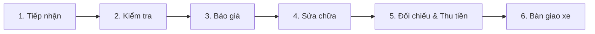

# Skill: Phát triển ứng dụng Garage Ô tô Đức Dũng

Kỹ năng này hướng dẫn các nhà phát triển và agent cách viết code, tổ chức module và tuân thủ các quy tắc nghiệp vụ trong dự án Quản lý Garage Ô tô Đức Dũng.

---

## 1. Kiến trúc & Tổ chức Code

Mô hình dự án tuân thủ nghiêm ngặt mô hình 3 tầng:
* `src/entity/`: Các POJO đại diện cho thực thể CSDL (thuộc tính private, getter/setter, constructor, equals/hashCode).
* `src/dao/`: Tầng truy cập dữ liệu JDBC thuần. Sử dụng `PreparedStatement` với tham số `?` để chống SQL Injection.
* `src/ui/`: Giao diện Java Swing:
  * `src/ui/component/`: Các component tái sử dụng (Header, Sidebar, Navigation, Theme).
  * `src/ui/dialog/`: Các hộp thoại tương tác chia theo vai trò (`kythuat`, `quanly`, `thungan`, `tiepnhan`).
  * `src/ui/screen/`: Các panel màn hình chính chia theo vai trò.

### Quy tắc bất biến:
1. **Không tạo lớp Service hay Controller**: UI gọi trực tiếp DAO.
2. **Không lưu trữ trên RAM**: Toàn bộ dữ liệu CRUD phải đọc/ghi từ SQL Server.
3. **Mỗi luồng có Connection riêng**: Gọi `ConnectDB.getInstance().getConnection()`.

---

## 2. Luồng nghiệp vụ chuẩn 6 bước



1. **Tiếp nhận xe**:
   * Kiểm tra thông tin khách hàng và xe (nếu chưa có thì thêm mới).
   * Lập phiếu tiếp nhận và **phân công kỹ thuật viên kiểm tra** ngay lúc lập phiếu.
2. **Kiểm tra xe**:
   * Kỹ thuật viên kiểm tra thực tế xe, ghi nhận hiện trạng và đề xuất sửa chữa.
   * Hoàn tất báo cáo kiểm tra (`HOAN_TAT`) để làm căn cứ bất biến cho báo giá.
3. **Báo giá & Duyệt**:
   * Nhân viên tiếp nhận lập báo giá từ báo cáo kiểm tra.
   * Gửi khách hàng và ghi nhận phản hồi (Đồng ý / Từ chối).
   * Nếu có điều chỉnh sau khi gửi: tạo phiên bản báo giá mới (`PhienBan`), không ghi đè bản cũ.
4. **Sửa chữa & Quản lý vật tư**:
   * Tiếp nhận phát hành lệnh sửa chữa từ báo giá mới nhất được duyệt.
   * Kỹ thuật viên nhận xe, ghi nhận phụ tùng thực dùng và báo cáo phát sinh nếu có.
   * Nếu phụ tùng xuất kho không dùng hết: phải **hoàn phụ tùng** trước khi Thu ngân chốt đối chiếu.
5. **Đối chiếu & Thu tiền**:
   * Thu ngân mở màn hình đối chiếu chi phí: hệ thống tự động tổng hợp tiền công thực tế + phụ tùng dùng ròng (đã trừ hoàn) + phát sinh khách đồng ý.
   * Ghi nhận thanh toán (tiền mặt / chuyển khoản), xác minh tiền về, sau đó mới lập hóa đơn bất biến.
6. **Bàn giao xe**:
   * Nhân viên tiếp nhận kiểm tra nghĩa vụ thanh toán (`DaThanhToan = 1` hoặc số tiền còn nợ = 0).
   * Trường hợp khách chưa thanh toán đủ: phải có **Phê duyệt ngoại lệ** từ Quản lý mới được bàn giao.

---

## 3. Quy chuẩn viết code DAO

* Luôn đóng tài nguyên theo chuẩn `try-with-resources`:
  ```java
  String sql = "SELECT * FROM dbo.KhachHang WHERE MaKH = ?";
  try (Connection conn = ConnectDB.getInstance().getConnection();
       PreparedStatement ps = conn.prepareStatement(sql)) {
      ps.setString(1, maKH);
      try (ResultSet rs = ps.executeQuery()) {
          if (rs.next()) {
              // map entity
          }
      }
  }
  ```
* Với các nghiệp vụ nhiều bước hoặc gọi Procedure phức tạp, sử dụng Transaction:
  ```java
  Connection conn = ConnectDB.getInstance().getConnection();
  boolean autoCommitCu = conn.getAutoCommit();
  try {
      conn.setAutoCommit(false);
      // Thực hiện các câu lệnh cập nhật
      conn.commit();
  } catch (SQLException ex) {
      conn.rollback();
      throw ex;
  } finally {
      conn.setAutoCommit(autoCommitCu);
  }
  ```
* Bắt ngoại lệ và ghi log lỗi đầy đủ, trả về thông báo lỗi rõ ràng cho người dùng ở tầng UI thay vì nuốt ngoại lệ.
